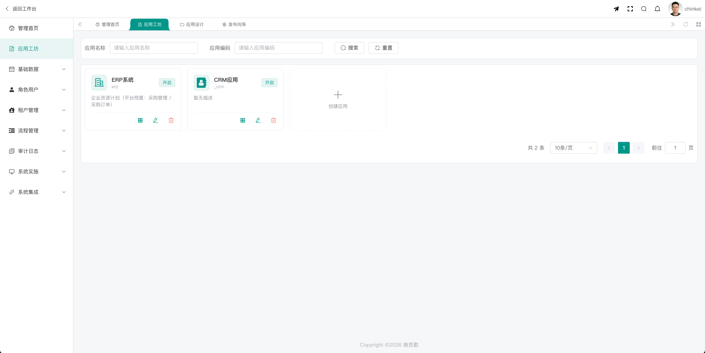
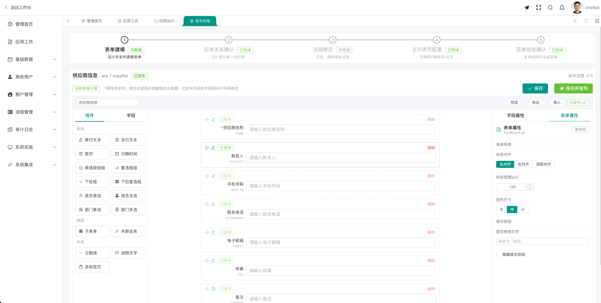
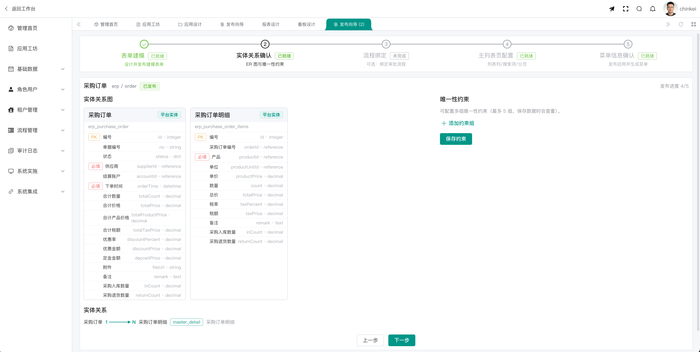
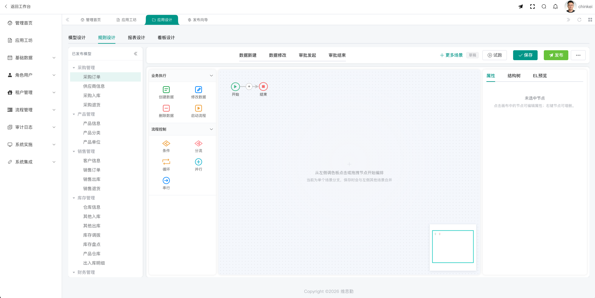
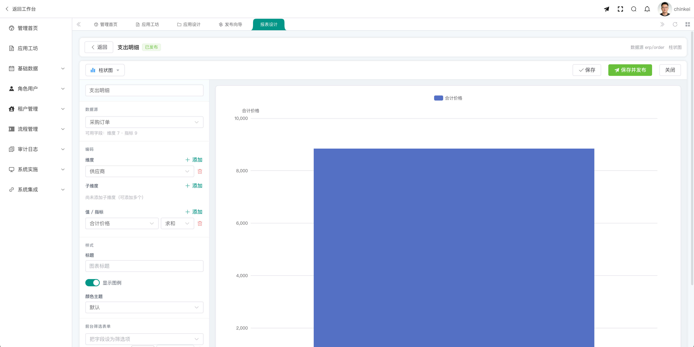
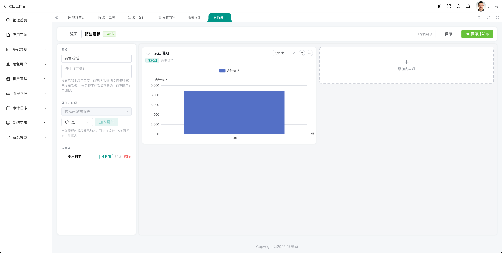
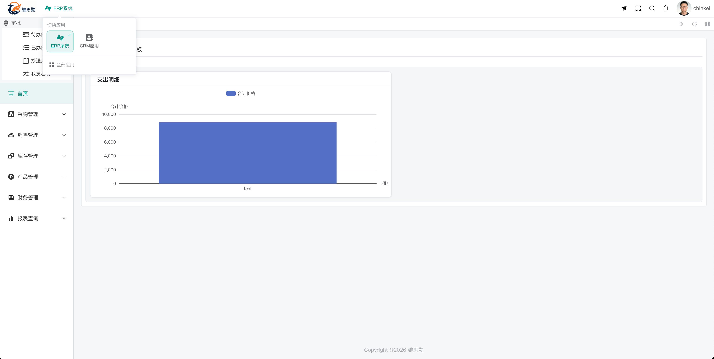

# 维思勤低代码平台（Vastgin Low-Code Platform）

  
  
  

> [维思勤](https://www.vastgin.com）即将推出的低代码平台 —— 通过可视化配置与元数据驱动的方式，让业务系统「搭」出来而不是「写」出来。

## 📖 目录

- [项目简介](#-项目简介)
- [产品定位与愿景](#-产品定位与愿景)
- [界面预览](#-界面预览)
- [核心能力](#-核心能力)
- [已开源项目](#-已开源项目)
- [关于维思勤](#-关于维思勤)

## 📌 项目简介

本项目是**维思勤即将推出的低代码平台**，目前仍处于**逐步完善中**的阶段。平台以「应用、数据模型、表单、规则流程、报表看板」等可复用能力为内核，采用**元数据 + JSON 契约**驱动的设计思想：在管理端通过五步发布向导完成「表单建模 → 实体关系确认 → 流程/规则绑定 → 主列表配置 → 菜单发布」，把配置结果自动生成数据表、菜单与页面，让业务系统「搭」出来而不是「写」出来。

我们将**基于该平台优先、重点打造面向中小企业（SME）的 ERP 数字化解决方案**，覆盖从基础数据、业务流程到经营分析的典型数字化场景，帮助中小企业以更低成本、更快速度完成数字化转型。

## 🎯 产品定位与愿景

- **低代码平台内核**：以表单引擎、报表引擎等为代表的基础能力，构建可组合、可扩展的应用搭建底座。
- **中小企业 ERP 数字化解决方案**：以平台为地基，聚焦中小企业真实业务场景，沉淀开箱即用的 ERP 业务能力。
- **拥抱开源生态**：未来会在开源方向持续做一些贡献，与社区一起成长。目前**前端已率先开源两款表单及报表设计页面**，供大家学习与参考。

## 📷 界面预览

> 截图位于 `./docs/images/`，原图为 2x 超清（3840px），此处**默认以小图展示，点击图片可查看全文**。

### 管理端 · 应用与建模

| 应用工坊 | 发布向导 ① 表单建模 |
| :---: | :---: |
|  |  |
| 以应用为顶层容器（ERP / CRM），卡片式创建与启停 | 组件/字段双面板拖拽建模，字段与表单双属性页 |

| 发布向导 ② 实体关系确认 | 应用设计 · 规则设计 |
| :---: | :---: |
|  |  |
| 自动推导 ER 图与主从（1→N）关系，配置唯一性约束 | 业务执行 + 流程控制节点可视化编排，支持 EL 预览与试跑 |

### 管理端 · 报表与看板

| 报表设计 | 看板设计 |
| :---: | :---: |
|  |  |
| 数据源取自已发布模型，维度/指标绑定通道并实时预览 | 已发布报表按 12 栅格与宽度编排，发布至前台首页 |

### 运行时 · 业务门户

| 前台门户与多应用切换 |
| :---: |
|  |
| 按应用切换，自动生成采购/销售/库存/产品/财务等业务菜单与看板首页 |

## 🔧 核心能力

平台围绕「配置即应用」的思路，形成「**建模 → 编排 → 呈现 → 运行**」的闭环（持续完善中）：

| 模块 | 能力说明 |
| --- | --- |
| **应用工坊** | 以应用为顶层容器管理 ERP / CRM 等多个应用，支持应用名称与编码检索、启停、复制进入设计与发布向导。 |
| **模型设计** | 表单元数据即数据模型：字段标识、类型、必填与校验在建模阶段确定，保存并发布后自动生成/同步该模型的元数据。 |
| **发布向导** | 五步式发布：表单建模 → 实体关系确认（ER 图 / 唯一性约束）→ 流程绑定 → 主列表配置（列/搜索项/分页）→ 菜单信息确认；每步状态可视（已就绪/未完成），发布进度可跟踪、可回退。 |
| **规则与流程编排** | 拖拽编排「业务执行」（创建数据、修改数据、删除数据、启动流程）与「流程控制」（条件、分流、循环、并行、串行）节点；按场景（数据新建 / 数据修改 / 审批发起 / 审批结束）分别设计，支持结构树、EL 预览与试跑。 |
| **报表设计** | 数据源来自已发布模型（自动列出可用维度与指标），维度/子维度/值指标（含聚合方式）绑定到图表通道，样式、颜色主题与前台筛选表单可配，实时渲染并可保存发布。 |
| **看板设计** | 将已发布报表以 12 栅格、可选宽度（1/2、1/3 等）编排为看板，支持内容项增删与排序，发布后在前台首页并列呈现。 |
| **运行时门户** | 前台按应用切换，依据发布结果自动生成业务菜单（采购 / 销售 / 库存 / 产品 / 财务 / 报表查询）与审批中心（待办、已办、抄送、我发起），配置即时可用。 |
| **平台底座** | 基础数据、角色与用户、租户管理、审计日志、系统实施、系统集成等平台级能力，支撑多租户交付与后续集成。 |

**设计原则：**

- **元数据驱动**：底层数据模型采用元数据驱动模式，扩展性与灵活性并重。
- **稳定的 Schema 契约**：以纯 JSON 描述应用结构，作为设计、渲染与持久化之间的唯一契约。
- **配置一次，多端生效**：同一份字段定义同时驱动设计面板、画布预览、列表列、前台表单与运行态渲染。
- **可插拔扩展**：提供插拔式扩展能力，解决个性化场景需求开发。

## 🌐 已开源项目

目前前端已开源两款**表单及报表设计页面**（分别对应上文「发布向导 · 表单建模」与「报表设计 / 看板设计」的独立可运行版本），供大家学习参考：

### 1. 在线表单引擎 · [form-engine-vue](https://github.com/vastgin/form-engine-vue)

基于 **form-create + Vue 3 + Element Plus** 的 **JSON 驱动**在线表单引擎，提供「**设计器 / 渲染器 / schema 契约**」三层能力。引擎级 `form-schema` 与 form-create 的 `rule` 完全解耦，通过适配层单向转换。

- **设计器（FormDesigner）**：拖拽画布 + 所见即所得控件预览 + 属性面板（字段/表单双 tab）+ 校验/显隐/整表提交校验可视化配置 + 发布与字段复用 + 导入/导出。
- **渲染器（FormRenderer）**：加载 schema 实时填报，负责数据双向绑定、校验、显隐求值、只读/重置/提交输出。
- **Schema 契约（form-schema）**：描述一张表单的纯 JSON 结构，作为设计器输出、渲染器输入与持久化的稳定契约（当前契约版本 1.1）。

**亮点特性：**
- 🎨 **单一字段注册表驱动**：同一份字段定义同时驱动设计面板、画布预览、子表单单元格与运行态 rule 生成，杜绝「画布一套、填报一套」的漂移。
- 🧩 **统一渲染单轨**：新增字段类型仅需 2 处改动即可全链路自动生效。
- 📋 **子表单明细**：支持行增删、行数钳制、固定列、批量删除、单元格级校验。
- 🔒 **发布与字段复用**：发布后字段标识锁定，可反复发布并递增版本，删除后仍可原样拖回沿用标识。
- 🙈 **双轨隐藏**：静态隐藏（保留值）与条件显隐（剔除值）互不串台。
- ✍️ **字段标识命名护栏**：拦截系统保留字与 SQL 注入关键词。

**技术栈**：Vue 3.5 · Element Plus 2.8 · @form-create/element-ui · async-validator · vuedraggable · Vite 5 · TypeScript 5.6 · Vitest。

### 2. 报表引擎 · [report-engine-vue](https://github.com/vastgin/report-engine-vue)

一个**纯前端**的自研报表引擎页面：用 **JSON** 表示数据集并定义其元数据，通过设计器把**维度与指标（度量）绑定到图表编码通道**，实时渲染 **ECharts** 图表；支持 **24 种图表类型**、多图表看板布局，并以只读展示模式对外呈现。计算与渲染的边界通过一层报表查询接口契约解耦：当前由前端内存中的 mock 后端完成分组聚合，**接入真实后端时只需替换一个函数**。

**核心特性：**
- **元数据驱动**：数据集声明字段 `dataType` / `role`（维度或指标）/ 可用聚合方式，设计器据此约束可选绑定。
- **24 种图表类型**：柱状/条形、折线/面积、散点、饼/占比、分布/关系、金融/统计、层级、指标卡、表格，共 9 大分类。
- **编码通道**：`dimensions`（有序复合分组维度）、`colors`（图例/颜色拆分维度）、`values`（多指标 + 各自聚合方式）。
- **图表类型合法性校验**：越界时后端返回 `INVALID_BINDING`，前端图表选择器同步置灰。
- **计算 / 渲染分层**：后端产出 `chart / metric / table` 三选一数据载荷，前端只负责组装 ECharts option。
- **查询防抖与竞态安全**：仅参与计算的字段变化才触发请求，样式改动即时重渲染，过期响应被丢弃。
- **看板与持久化**：多图表 12 栅格布局、拖拽排序，定义与看板内容写入 localStorage，可导出为 JSON。

**技术栈**：Vue 3 + TypeScript · Vite 5 · ECharts 5 · Pinia · Element Plus · Vue Router · Vitest。

## 📬 关于维思勤

维思勤（Vastgin）致力于用低代码技术降低企业数字化门槛。平台尚在快速成长期，欢迎关注我们后续的正式发布与开源进展。

- GitHub：[https://github.com/vastgin](https://github.com/vastgin)
- 表单引擎：[form-engine-vue](https://github.com/vastgin/form-engine-vue)
- 报表引擎：[report-engine-vue](https://github.com/vastgin/report-engine-vue)
